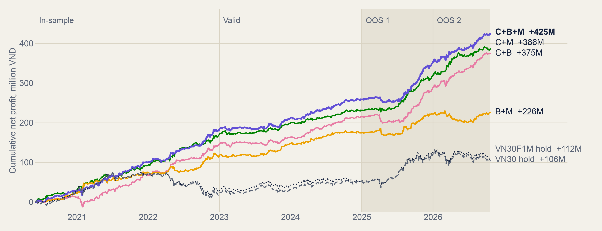
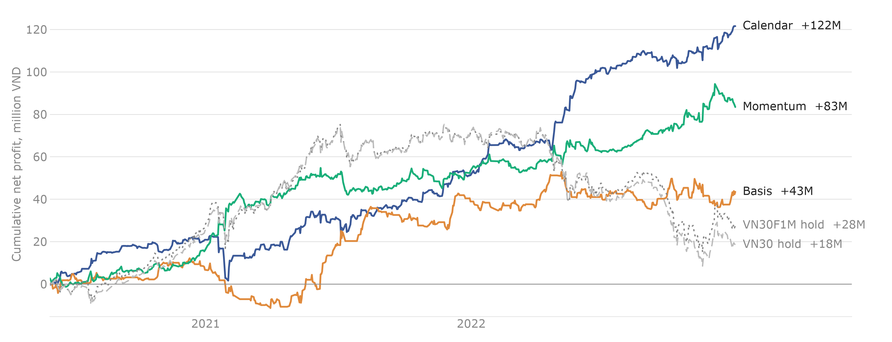
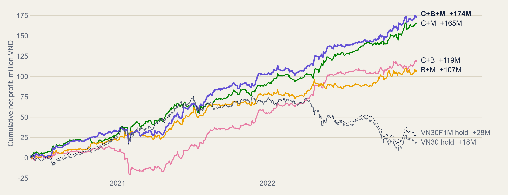
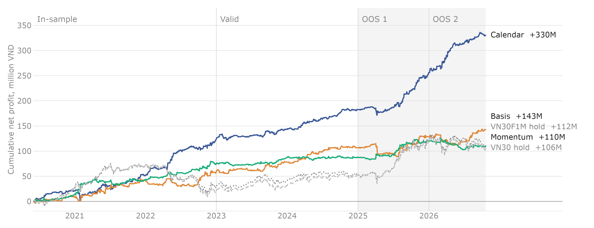
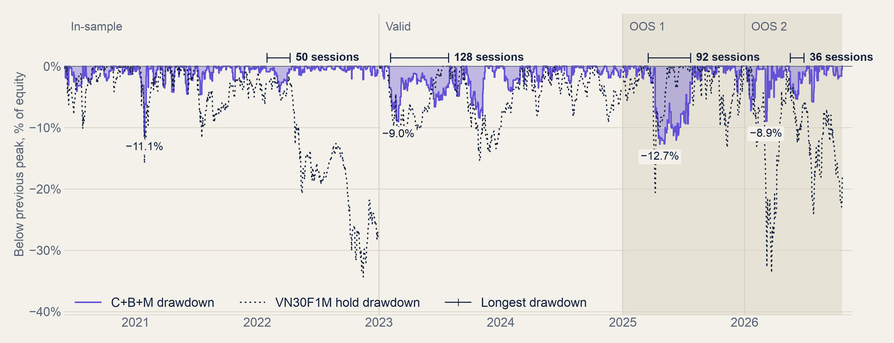
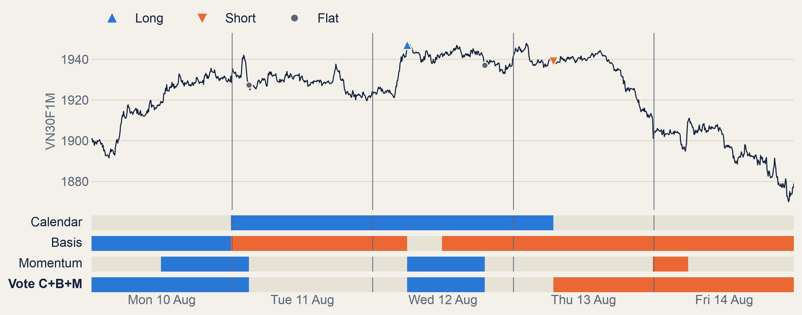

# Calibrum — three sources of alpha for VN30F1M

Calibrum trades the VN30 index futures front-month contract (VN30F1M). It combines three sources of alpha whose good and bad periods differ: a **Monday-to-Wednesday calendar**, **basis reversion** between the futures and the index, and **intraday momentum** measured by a Ridge regression. The three sleeves vote, and the strategy holds at most one contract.

This version is rebuilt on DNSE 1-minute data and follows steps 1 to 6 of the ALGOTRADE 9-step process. Over June 2020 – October 2026, with one set of parameters, it makes **425 million VND on 100 million VND of capital**, about four times holding the futures, and it stays profitable in both out-of-sample years.

| | In-sample 2020–22 | Valid 2023–24 | OOS 1 · 2025 | OOS 2 · 2026 |
|---|---:|---:|---:|---:|
| Net profit (million VND) | 180.8 | 77.5 | **94.9** | **71.7** |
| Sharpe | 2.76 | 2.03 | **3.20** | **2.87** |
| Sortino | 4.92 | 3.38 | 5.45 | 5.22 |
| Information ratio vs VN30F1M | 1.24 | 0.96 | 0.39 | 1.87 |
| Max drawdown | 11.1% | 9.0% | 12.7% | 8.9% |
| Longest drawdown (sessions) | 50 | 128 | 92 | 36 |

*Final combination C+B+M, one contract on 100 million VND, after a cost of 0.4 index points (40,000 VND) per side. OOS 2 runs to 21 Oct 2026.*



---

## Contents

1. [Forming hypotheses](#1-forming-hypotheses)
2. [Data preparation](#2-data-preparation)
3. [Hypotheses to rules](#3-hypotheses-to-rules)
4. [In-sample backtest](#4-in-sample-backtest)
5. [Optimization](#5-optimization)
6. [Out-of-sample backtest](#6-out-of-sample-backtest)
7. [Paper trading](#7-paper-trading)
8. [Reproduce](#reproduce)

## The market

| | |
|---|---|
| Underlying | VN30 index, the 30 largest and most liquid stocks on HOSE |
| Multiplier | 100,000 VND per index point, per contract |
| Sessions | 09:00 – 14:45, lunch 11:30 – 13:00, closing auction from 14:30 |
| Expiry | Third Thursday, earlier when it is a holiday; cash settled |
| Leverage | Initial margin 17% since Dec 2022 (13% before), about 6× |

Leveraged retail money reacts fast and in the same direction; momentum and the basis both feed on that.

---

## 1. Forming hypotheses

Every source of alpha has good and bad periods. When the sources rest on different mechanisms, the bad stretches of one tend to fall in the good stretches of another, so the combination earns more steadily (ALGOTRADE Knowledge Hub, *Capital Allocation and Beta Management*).

| Sleeve | Hypothesis | Who pays | Source of alpha |
|---|---|---|---|
| **Calendar MTW** | VN30F1M falls during Monday’s session and rises from Monday’s close to Thursday morning. | Forced sellers on Monday (weekend news, margin calls) and early bottom-pickers | Trading experience, behavioral bias |
| **Basis** | When futures minus VN30 stretches far from its recent average, it closes back within a few sessions, by more than a round trip’s cost. | Leveraged retail traders who move the contract faster than 30 stocks can follow; no short selling on HOSE keeps the gap open | Mispricing, local market structure |
| **Momentum** | A price that has been running one way during the session keeps running that way over the next hour. | Retail traders who chase late, and wrong-side traders who are stopped out | Behavioral bias, statistical model |

Each sleeve is tested and reported on its own, so a sleeve that fades can be watched and dropped without touching the others.

---

## 2. Data preparation

| | |
|---|---|
| Source | DNSE public chart API, one source for every price |
| VN30F1M | 463,982 one-minute bars, 13 Aug 2018 – 21 Oct 2026 |
| VN30 index | 360,098 one-minute bars, from 11 May 2020 (none earlier at any resolution) |
| Gaps | 126 sessions DNSE lacks at 1 minute (mostly Mar–Sep 2023) use DNSE 5-minute bars, which match the 1-minute bars exactly where both exist; 4 sessions missing at every resolution are skipped, never filled |
| Signal bars | 10-minute bars (Calendar) and 30-minute bars (Basis, Momentum), built from the minute bars |

**Periods** (`config/research.toml`):

| Period | Dates | Role |
|---|---|---|
| Warm-up | Aug 2018 – May 2020 | Indicators build history; never scored |
| **In-sample** | 1 Jun 2020 – 31 Dec 2022 | Fit the model, choose the parameters |
| Valid | 2023 – 2024 | Choose the final combination |
| OOS 1 | 2025 | Opened once, after every choice is fixed |
| OOS 2 | 1 Jan – 21 Oct 2026 | Opened once, after OOS 1 |
| Blind | from 22 Oct 2026 | Paper trading |

**Prices.** Fills, profit, costs, margin, stops, Basis and Calendar use the raw front-month price. The Momentum features alone use an additive roll-adjusted copy, because the continuous series jumps at each of the 99 contract changes (median 6.6 points, one in ten above 17.5) and the jump would otherwise enter the ATR and the averages.

---

## 3. Hypotheses to rules

### Calendar MTW (10-minute bars)

- **Short every Monday** at the close of the first bar between 09:30 and 13:00 that closes below the low of 09:00–09:29; exit at the close of the 14:20 bar. No break, no trade.
- **Long** at the close of the 14:20 bar of the session before Tuesday; exit at the close of the 10:00 bar of the session after Wednesday. Wednesday a holiday: skip the week.

Parameters come from the separate Calendar MTW research and are not re-optimized here.

### Basis (30-minute bars)

```math
B_t = F_t - I_t, \qquad Z_t = \frac{B_t - \mu_W(B)_t}{\sigma_W(B)_t}
```

Enter long when $`Z_t \le -z_{in}`$, short when $`Z_t \ge z_{in}`$; flip at the opposite extreme after at least 2 bars; stop at a 14-point loss checked at every minute; restart at each new contract; flat on expiry day and on days without index data.

### Momentum (30-minute bars, Ridge regression)

Five measures of how strongly the price is running, each in ATR units:

```math
x_1 = \frac{C_t - \mathrm{VWAP}_t}{\mathrm{ATR}_{14,t}}, \qquad x_2 = \frac{C_t - O_{\text{09:00}}}{\mathrm{ATR}_{14,t}}, \qquad x_3 = \frac{C_t - \mathrm{SMA}_4(C)_t}{\mathrm{ATR}_{14,t}}
```

```math
x_4 = \frac{\sum_4 \mathrm{up}^2 - \sum_4 \mathrm{down}^2}{\sum_4 \mathrm{up}^2 + \sum_4 \mathrm{down}^2}, \qquad x_5 = \frac{C_t - O_t}{\mathrm{ATR}_{14,t}}, \qquad z_j = \mathrm{clip}\left(\frac{x_j - \mathrm{med}_j}{\mathrm{IQR}_j},\ -8,\ 8\right)
```

The target is the next hour’s move, and the weights minimise the fit error plus a penalty:

```math
y_t = \frac{C_{t+2} - C_t}{\mathrm{ATR}_{14,t}}, \qquad J(\beta_0, \beta) = \frac{1}{n}\sum_t \left(y_t - \beta_0 - z_t^{\top}\beta\right)^2 + \lambda \lVert \beta \rVert^2
```

Score $`s_t = \beta_0 + z_t^{\top}\beta`$. Enter long when $`s_t \ge \theta`$, short when $`s_t \le -\theta`$, with $`\theta`$ the $`q`$-th percentile of $`|s|`$ on in-sample. Exit after at least 2 bars when the score changes sign, or after 8 bars; stop at a 10-point loss checked at every minute; flat from 14:00 on expiry day.

### Combining

```math
p_t = \mathrm{sign}\left(p^C_t + p^B_t + p^M_t\right)
```

All seven combinations (C, B, M, C+B, C+M, B+M, C+B+M) are tested; each holds at most one contract on 100 million VND.

---

## 4. In-sample backtest

**Execution.** Fill at the close of the bar that gave the signal; stops checked and filled at the close of every minute; no new decision in the closing auction; flat on expiry day; every position closed on the last bar of its contract.

**Cost.** 0.4 index points (40,000 VND) per contract per side. Exchange, clearing and tax are 11,000–16,000 VND under Plutus’s dated rulebook; the rest covers broker commission and slippage.

**Size.** One contract on 100 million VND, always; profits are not reinvested, so 1 million VND of profit is 1% return. Initial margin (dated by Plutus) takes about 20% of capital in 2022 and 36% in 2026, far from a margin call.

**Metrics.** Sharpe follows Plutus (`plutus.evaluation.metrics`): $`r_t = \mathrm{PnL}_t / \mathrm{Equity}_{t-1}`$, $`\mathrm{Sharpe} = \sqrt{250}\,(\bar{r} - r_f/250)/\sigma_r`$ with $`r_f = 3\%`$. Sortino uses the same 3% as its threshold and only downside deviation; the information ratio is $`\sqrt{250}\,\overline{(r - r_b)}/\sigma_{r - r_b}`$ against holding one VN30F1M contract on the same capital; the longest drawdown counts sessions from a peak to the next new peak. Also net profit, max drawdown, margin (net profit ÷ value traded, bps), trades, hit rate.

**Starting parameters** (before optimization): Basis W = 40, z_in = 1.5; Momentum λ = 1, trade the strongest 20% of scores.

| Combination | Net (M VND) | Sharpe | Max DD | Trades |
|---|---:|---:|---:|---:|
| C | 121.5 | 1.93 | 17.2% | 205 |
| B | 43.4 | 0.71 | 20.9% | 209 |
| M | 83.4 | 1.56 | 8.2% | 451 |
| C+B | 119.3 | 1.58 | 30.3% | 304 |
| C+M | 164.7 | 2.54 | 9.9% | 452 |
| B+M | 107.5 | 1.74 | 8.1% | 462 |
| **C+B+M** | **173.9** | **2.59** | 12.7% | 488 |





Holding the market made only 28 million (futures) and 18 million (index) in-sample, and gave most of it back in 2022. The daily profits of the sleeves barely move together (C–B −0.09, C–M +0.15, B–M −0.07), which is why the combination is steadier than any sleeve.

---

## 5. Optimization

All choices use in-sample only.

**Momentum penalty λ.** Four expanding folds inside in-sample (fit from June 2020, test on 2021-H1, 2021-H2, 2022-H1, 2022-H2; 2 bars purged at the seam):

```math
\lambda^* = \arg\min_{\lambda} \frac{1}{4}\sum_{f=1}^{4} \mathrm{MSE}_f(\lambda)
```

| λ | 0.01 | 0.1 | **1** | 10 | 100 |
|---|---:|---:|---:|---:|---:|
| Test MSE | 1.4964 | 1.4942 | **1.4930** | 1.5090 | 1.5223 |
| Test IC | 0.108 | 0.109 | **0.113** | 0.113 | 0.113 |

λ = 1 predicts direction on unseen data in all four folds (IC 0.08 to 0.16). All five fitted weights are positive (open +0.057, VWAP +0.038, 4-bar average +0.026, body +0.019, up/down +0.018): a price far from VWAP keeps going too.

**Momentum threshold.** Trading only the strongest 10% of scores halves the cost and gives the best Sharpe; all three settings profit:

| Trade the strongest | Trades | Hit rate | Cost (M VND) | Net (M VND) | Sharpe |
|---|---:|---:|---:|---:|---:|
| 30% | 566 | 43% | 45.3 | 90.0 | 1.54 |
| 20% | 451 | 46% | 36.1 | 83.4 | 1.56 |
| **10%** | 279 | 50% | 22.3 | 73.2 | **1.57** |

**Basis grid.** Sharpe after costs; each cell is scored by the mean Sharpe of its 3 × 3 neighbourhood, so a lucky single cell is not chosen:

| W \ z_in | 1.00 | 1.25 | 1.50 | 1.75 | 2.00 |
|---|---:|---:|---:|---:|---:|
| 20 | 0.28 | 0.18 | 0.24 | 0.27 | 0.17 |
| 30 | −0.15 | 0.54 | 0.55 | 0.44 | −0.07 |
| 40 | 0.49 | 0.84 | 0.71 | 0.63 | 0.50 |
| 50 | 0.98 | 0.82 | 1.09 | 1.18 | 0.70 |
| 60 | 0.74 | 0.88 | **0.99** | 1.23 | 0.88 |

Chosen W = 60, z_in = 1.5 (region 1.03, the best; all six neighbours profit). Basis earns for the stated reason: 79% of 380 stretches past 1.5 closed at least halfway within 8 bars, and 91% of its gross profit (63.6 of 69.9 M VND) came from the basis closing, only 6.3 M from the index moving.

**Carried to step 6:** Calendar unchanged; Basis W = 60, z_in = 1.5; Momentum λ = 1, strongest 10% of scores (θ = 0.232).

---

## 6. Out-of-sample backtest

**Valid 2023–2024** chooses the final combination: the highest Sharpe on valid is **C+B+M** (2.03). Every sleeve and combination stays profitable.

| Combination | Valid net | Sharpe | 2025 net | Sharpe | 2026 net | Sharpe |
|---|---:|---:|---:|---:|---:|---:|
| C | 60.2 | 1.83 | 73.5 | 2.49 | 74.3 | 3.32 |
| B | 49.4 | 1.46 | 21.9 | 0.78 | 14.3 | 0.67 |
| M | 13.7 | 0.42 | 32.7 | 1.80 | −9.3 | −0.77 |
| C+B | 71.5 | 1.94 | 73.7 | 2.38 | 86.5 | 3.64 |
| C+M | 62.3 | 1.76 | 89.2 | 3.05 | 66.2 | 2.82 |
| B+M | 59.9 | 1.77 | 47.8 | 1.68 | 4.5 | 0.23 |
| **C+B+M** | **77.5** | **2.03** | **94.9** | **3.20** | **71.7** | **2.87** |

*Net profit in million VND on 100 million VND. 2026 runs to 21 Oct.*




| C+B+M | In-sample | Valid | 2025 | 2026 |
|---|---:|---:|---:|---:|
| Sortino | 4.92 | 3.38 | 5.45 | 5.22 |
| Information ratio vs VN30F1M | 1.24 | 0.96 | 0.39 | 1.87 |
| Longest drawdown (sessions) | 50 | 128 | 92 | 36 |
| Holding VN30F1M (M VND) | 27.6 | 27.0 | 71.0 | −13.3 |



Sortino is close to twice Sharpe in every period: most of the variance is on the upside. The information ratio is low in 2025 because the market rallied and the strategy, which barely moves with it, tracks it loosely even while making more; in 2026 the market fell and the ratio rises to 1.87. The longest drawdown, 128 sessions (31 Jan – 2 Aug 2023), is the yardstick for paper trading. The same metrics for every combination are in [`RESULTS.md`](research/calibrum-1m/RESULTS.md).

Over six years, holding one futures contract made 112 million VND and the index 106 million, mostly in 2025; C+B+M made 425 million and kept climbing through 2021–2024, when the market went nowhere.

**One week inside the vote** (10–14 Aug 2026, out of sample): two sleeves out of three decide, and a lone sleeve is outvoted. Calendar long against Basis short keeps the vote flat on Tuesday; Momentum joining Calendar turns it long on Wednesday; Basis alone carries it short through Thursday and Friday while the price falls about 70 points.



**Watching each sleeve.**

| Sharpe alone | In-sample | Valid | 2025 | 2026 |
|---|---:|---:|---:|---:|
| Calendar | 1.94 | 1.83 | 2.49 | 3.32 |
| Basis | 0.99 | 1.46 | 0.78 | 0.67 |
| Momentum | 1.57 | 0.42 | 1.80 | −0.77 |
| Momentum IC | 0.113 | 0.071 | 0.086 | −0.004 |

| Daily-profit correlation | C–B | C–M | B–M |
|---|---:|---:|---:|
| In-sample | −0.17 | 0.04 | 0.00 |
| Valid | 0.12 | 0.22 | 0.05 |
| 2025 | −0.17 | 0.09 | 0.06 |
| 2026 | −0.25 | 0.03 | −0.01 |

Momentum’s score stopped predicting the next hour in 2026 (IC ≈ 0); the combination stayed strongly positive because the other two sleeves outvote it, and the correlations stay low in every period. If Momentum’s IC stays near zero, it is the sleeve to drop.

The full record, including every amendment made after a result was seen, is in [`research/calibrum-1m/PROTOCOL.md`](research/calibrum-1m/PROTOCOL.md) and [`RESULTS.md`](research/calibrum-1m/RESULTS.md).

---

## 7. Paper trading

Paper trading on the exchange’s paper platform has run since 25 Aug 2026 (`papertrade/`, deployed on AWS). Calibrum C+B+M is the next strategy to deploy there; from 22 Oct 2026 the data is blind.

---

## Reproduce

Python 3.12 with [uv](https://docs.astral.sh/uv/); `plutus/` is a git submodule.

```bash
make setup                 # submodule + locked environment
make fetch-data            # DNSE 1-minute and 5-minute bars into data/dnse/
make step5                 # Ridge λ by cross-validation, Momentum threshold, Basis grid (in-sample only)
make step4                 # seven combinations with the starting parameters
make step6                 # valid, then OOS 1 and OOS 2 (each opens once)
make figures               # benchmarks and equity charts → reports/calibrum_1m/figures/
make week START=2026-08-10 END=2026-08-14
make check                 # tests, lint, compile
```

| Path | What |
|---|---|
| `config/research.toml` | Data, periods, execution, account and cost |
| `src/adapters/data/dnse_minute_bars.py` | Minute-bar base, 5-minute fallback, 10/30-minute bars, roll adjustment |
| `src/adapters/strategies/calendar_mtw_signal_source.py` | Calendar MTW sleeve |
| `src/lab/calibrum_1m/` | Momentum, Basis, minute-grid engine and scoring |
| `src/lab/backtest/` | Position-stream accounting and metrics |
| `scripts/run_calibrum_1m.py` | One protocol step per stage |
| `research/calibrum-1m/` | Protocol (locked before the runs) and results |
| `papertrade/` | Step 7 paper runtime |
