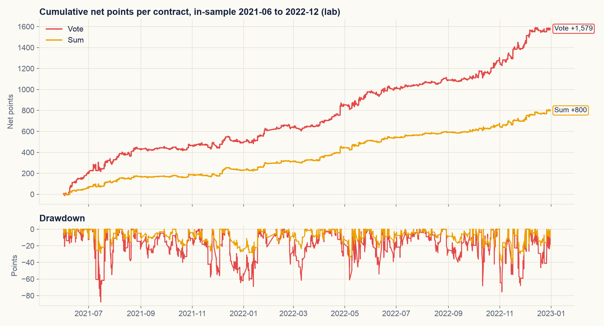

# 4. Backtest in-sample

Giai đoạn: 01/06/2021 đến 30/12/2022 (401 phiên). Cấu hình: luật ở chương 3 với tham số ban đầu ở mục 4.1, roll guard bật cho
Basis và tắt cho Momentum, ensemble về 0 từ 14:00 ngày đáo hạn.

## 4.1 Tham số ban đầu

Bước 4 chạy với giá trị có sẵn trong gói đóng băng, chưa chỉnh gì. Ký hiệu theo mục 3.6.

### Momentum

| Đặc trưng | β_j | μ_j | s_j |
|---|---:|---:|---:|
| Hệ số chặn β_0 | −0,0206 | | |
| f1 (so với Open 09:00) | +0,1472 | 0,0924 | 0,9554 |
| f2 (so với SMA) | +0,0464 | 0,1029 | 0,8685 |
| f3 (thân nến) | +0,0423 | 0,0314 | 0,6212 |
| f4 (bất đối xứng) | +0,0190 | 0,0000 | 1,0000 |
| f5 (so với VWAP) | −0,0396 | 0,0366 | 0,4319 |

β, μ và s được fit trên dữ liệu 2020 đến 2022 trước khi đóng gói (`config.json`, mục `data`), nên trùng với in-sample
(xem 6.3). Dấu của cả năm hệ số khớp với dấu kỳ vọng ở mục 3.1.

| Tham số | Giá trị |
|---|---|
| c | 8 |
| n_ATR, n_SMA, n_A | 14, 4, 4 nến |
| θ_M | 0,18 |
| h_M, H_M | 2, 8 nến |
| L_M | 10 điểm |

### Basis

| Tham số | Giá trị |
|---|---|
| W | 40 nến |
| W_min | 15 nến |
| z_in, z_out | 1,5; 0,0 |
| h_B | 2 nến |
| L_B | 14 điểm |

Vì z_out = 0, điều kiện thoát |Z| ≤ z_out gần như không bao giờ xảy ra; lệnh kết thúc bằng đảo chiều hoặc cắt lỗ.

### Calendar

| Tham số | Giá trị |
|---|---|
| D_long | Thứ Ba, thứ Tư |
| k | 2 phiên |
| g_max | 0,0 điểm |
| T_end | 14:30 |
| Chân phụ | Bật cả bốn: đầu tháng, trước kỳ nghỉ, bán thứ Hai, đáo hạn |

### Ensemble

| Tham số | Giá trị |
|---|---|
| w_M, w_B, w_C | 1, 1, 1 |
| N | 3 hợp đồng (vote); sum dùng 1 hợp đồng mỗi đơn vị, tối đa 3 |

## 4.2 Các chỉ số đo

### Lab (điểm chỉ số, 1 hợp đồng)

Ký hiệu: `Pos[t]` là vị thế quyết định tại giá đóng của nến `t`; `D` là lãi lỗ net (điểm) của một phiên, tính cả những
phiên không giao dịch.

| Chỉ số | Định nghĩa |
|---|---|
| Lãi net sau phí | Σ NetGain[t], với NetGain[t] = Pos[t−1] · (Close[t] − Close[t−1]) − 0,4 · \|Pos[t] − Pos[t−1]\| |
| Sharpe sau phí | mean(D) / std(D) · √252, R_f = 0 |
| Sortino | mean(D) / √mean(min(D, 0)²) · √252 |
| Max drawdown (điểm) | Mức sụt lớn nhất của lãi lũy kế tính từ một đỉnh trước đó; tính theo % thì chia cho giá đóng tại đáy |
| Margin sau phí (bps) | Lãi net / Σ (Close · \|Pos[t] − Pos[t−1]\|) × 10.000: lãi trên mỗi đơn vị giá trị giao dịch, tính cả chiều vào lẫn chiều ra |
| Số lệnh | Σ \|Pos[t] − Pos[t−1]\| / 2, số vòng mua bán 1 hợp đồng |
| Hit rate | Tỷ lệ lệnh có lãi gộp dương; một lệnh là chuỗi nến liền nhau có cùng dấu vị thế |
| Lãi mỗi năm | Lãi net / (số phiên − 1) × 252 |
| Calmar | Lãi mỗi năm / max drawdown tính bằng điểm |
| Profit factor | Tổng các phiên lãi / \|tổng các phiên lỗ\| |

"Margin" ở đây là biên lợi nhuận trên giá trị giao dịch, không phải tiền ký quỹ ở mục 4.4.

Giải thích từng công thức và một bài tập tự tính nằm ở [exercise/](exercise/).

### Plutus (đồng, trên vốn tài khoản)

| Chỉ số | Định nghĩa |
|---|---|
| Lãi lỗ net | Vốn cuối − vốn đầu; quy ra điểm chỉ số bằng cách chia cho 100.000 |
| Lợi suất, lợi suất năm | Vốn cuối / vốn đầu − 1; (vốn cuối / vốn đầu)^(252 / số phiên) − 1 |
| Sharpe | mean(r) / std(r) · √252, r = lợi suất tài khoản theo ngày tại cuối phiên, R_f = 0 |
| Max drawdown | Mức sụt lớn nhất của tài khoản tính từ một đỉnh trước đó, theo % |
| Tổng phí | Phí HNX, VSDC và thuế TNCN, tính theo từng lệnh khớp |
| Tỷ lệ sử dụng ký quỹ cao nhất | Giá trị lớn nhất của ký quỹ yêu cầu / tài sản ký quỹ hợp lệ; cảnh báo ở 80%, gọi ký quỹ ở 90%, thanh lý bắt buộc ở 100% |

## 4.3 Lab

Lệnh: `make step4 ENSEMBLE=vote`, `make step4 ENSEMBLE=sum` (cache DNSE, phí 0,8 điểm mỗi vòng).
Report: `reports/step4_insample_lab_{vote,sum}.json`.

| Chỉ số | Majority vote (tối đa 1 hợp đồng) | Equal-weight sum (tối đa 3 hợp đồng) | Sum quy về 1 hợp đồng (÷ 3) |
|---|---:|---:|---:|
| Lãi net sau phí (điểm) | +1.579,4 | +2.400,1 | +800,0 |
| Phí (điểm) | 226,0 | 383,2 | 127,7 |
| Sharpe sau phí | 3,70 | 3,60 | 3,60 |
| Max drawdown (điểm) | 87,7 | 121,4 | 40,5 |
| Margin sau phí (bps) | 20,66 | 18,56 | 18,56 |
| Hit rate | 52,7% | 49,8% | 49,8% |
| Sortino | 8,00 | 8,60 | 8,60 |
| Calmar | 11,35 | 12,46 | 12,46 |
| Lãi mỗi năm (điểm) | 995,0 | 1.512,1 | 504,0 |

Vị thế của sum lên tới 3 hợp đồng, nên điểm, phí và drawdown của nó được chia 3 để so với vote trên cùng 1 hợp đồng;
Sharpe, margin và các tỷ số không đổi theo quy mô.

Hình tạo bằng `scripts/generate_report_plots.py`; hình của từng lần chạy nằm ở
`reports/figures/step4_insample_lab_{vote,sum}_*.png`.

## 4.4 Plutus

Lệnh: `make calibrum-insample ENSEMBLE=vote`, `make calibrum-insample ENSEMBLE=sum`. Vốn 300 triệu đồng, tối đa 3 hợp
đồng, khớp mềm. Report: `reports/calibrum_plutus_insample_{vote3,sum3}_300m.json`. Cả hai lần chạy: trạng thái
PASSED, 401 phiên đầy đủ.

| Chỉ số | Majority vote (3 × sign) | Equal-weight sum (M + B + C) |
|---|---:|---:|
| Lãi lỗ net (đồng) | +451.844.180 | +311.765.232 |
| Lãi lỗ net (điểm chỉ số) | +4.518,4 | +3.117,7 |
| Lợi suất | +150,61% | +103,92% |
| Lợi suất năm | +78,13% | +56,49% |
| Sharpe | 4,12 | 4,37 |
| Max drawdown | 5,11% | 3,17% |
| Lệnh / khớp / hết hạn | 582 / 494 / 88 | 893 / 766 / 127 |
| Số hợp đồng giao dịch | 1.641 | 917 |
| Tổng phí (đồng) | 21.825.820 | 12.214.768 |
| Tỷ lệ sử dụng ký quỹ cao nhất | 20,6% | 18,7% |
| Cảnh báo, gọi ký quỹ, thanh lý | 0, 0, 0 | 0, 0, 0 |
| Số lần thanh toán đáo hạn | 14 | 14 |

Điểm chỉ số là số đồng chia cho 100.000 (một điểm trên một hợp đồng). Sharpe tính trên lợi suất tài khoản theo ngày.

Hai chi tiết về khớp lệnh:

- Lệnh nào mô hình khớp mềm không khớp được thì hết hạn, và được gửi lại ở nến sau vì vị thế mục tiêu vẫn như cũ. Vì vậy
  lệnh hết hạn là lệnh bị trễ, không phải lệnh bị mất.
- Trong phiên đáo hạn, lệnh đóng ở phiên ATC thường không khớp, nên vị thế được thanh toán theo giá thanh toán cuối cùng.
  Không vị thế nào giữ sang hợp đồng mới: phiên đáo hạn nào cũng kết thúc với vị thế bằng 0.

## 4.5 So sánh lab và Plutus

Để tách ảnh hưởng của dữ liệu khỏi ảnh hưởng của khớp lệnh, lab cũng được chạy trên nến của cơ sở dữ liệu
(`--source db`, `reports/step4_insample_lab_db_{vote,sum}.json`).

| | Vote, lab DNSE | Vote, lab DB | Vote, Plutus | Sum, lab DNSE | Sum, lab DB | Sum, Plutus |
|---|---:|---:|---:|---:|---:|---:|
| Lãi net (điểm), quy mô 3 hợp đồng | +4.738,2 | +4.712,7 | +4.518,4 | +2.400,1 | +2.382,2 | +3.117,7 |
| Sharpe | 3,70 | 3,85 | 4,12 | 3,60 | 3,56 | 4,37 |

Số của vote trên lab được nhân 3 cho khớp với lần chạy Plutus 3 hợp đồng. Sharpe của lab và Plutus tính trên hai cơ sở
khác nhau (điểm theo ngày và lợi suất tài khoản theo ngày), nên không so trực tiếp được.

- Dữ liệu: lab cho kết quả gần như nhau trên DNSE và trên cơ sở dữ liệu (lệch dưới 1%), nên hai nguồn dữ liệu khớp nhau.
- Chi phí: Plutus tính khoảng 0,13 điểm mỗi hợp đồng mỗi chiều (21,8 triệu đồng trên 1.641 hợp đồng), so với 0,4 của
  lab. Chỉ xét chi phí thì Plutus phải hơn lab khoảng 450 điểm với vote và 250 điểm với sum.
- Thời điểm khớp lệnh: lãi lỗ theo ngày của Plutus và của lab trên cơ sở dữ liệu tương quan 0,89 với vote và 0,88 với
  sum. Phần chênh còn lại, khoảng −650 điểm với vote và +480 điểm với sum, nhiều khả năng do thời điểm khớp: lệnh hết hạn
  rồi được gửi lại ở nến sau, và thanh toán đáo hạn thay vì thoát ở phiên ATC. Phần này chưa được lần theo từng lệnh.
- Cả hai ensemble đều lãi sau phí thật, không có cảnh báo ký quỹ nào, mức sử dụng ký quỹ cao nhất khoảng 20%.
