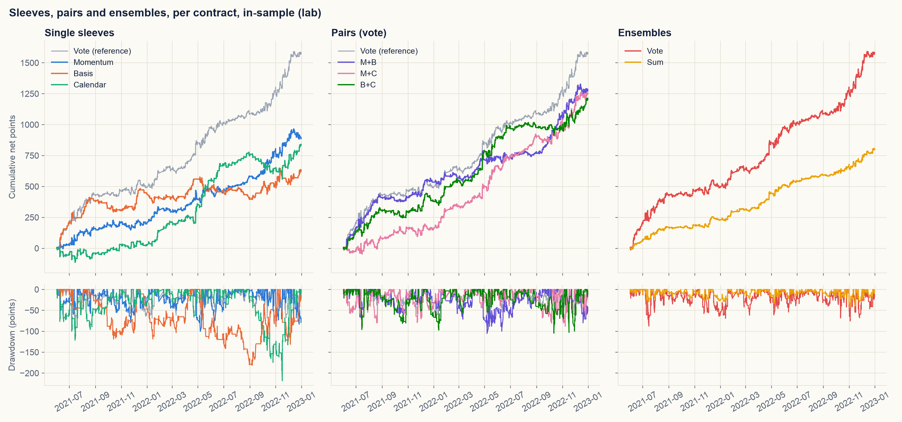
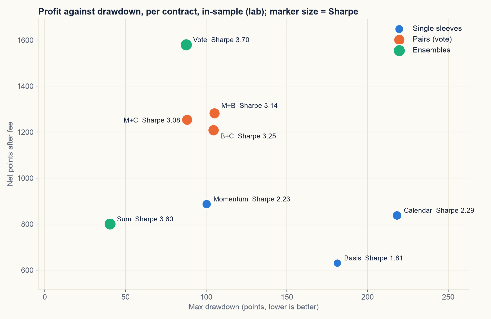
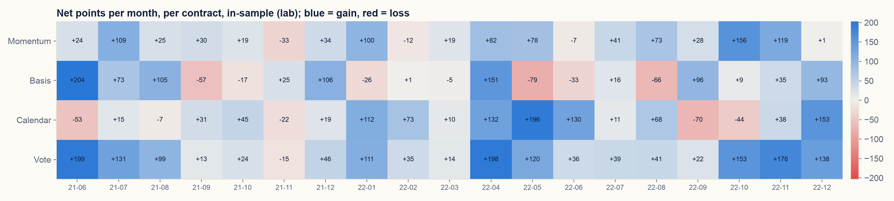
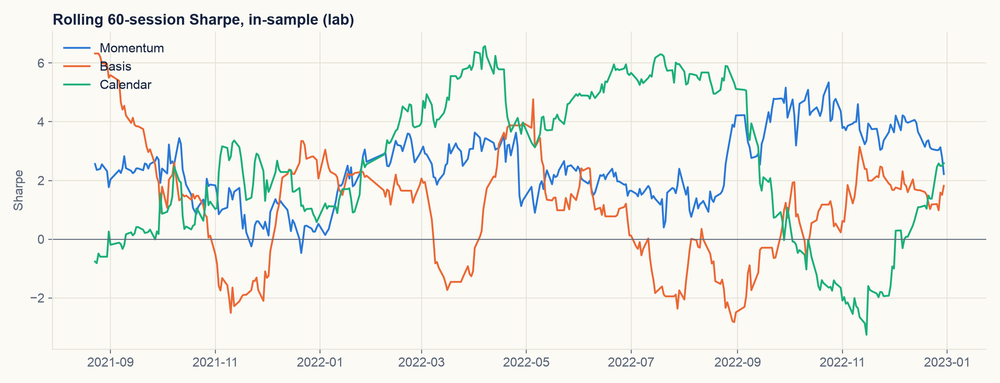
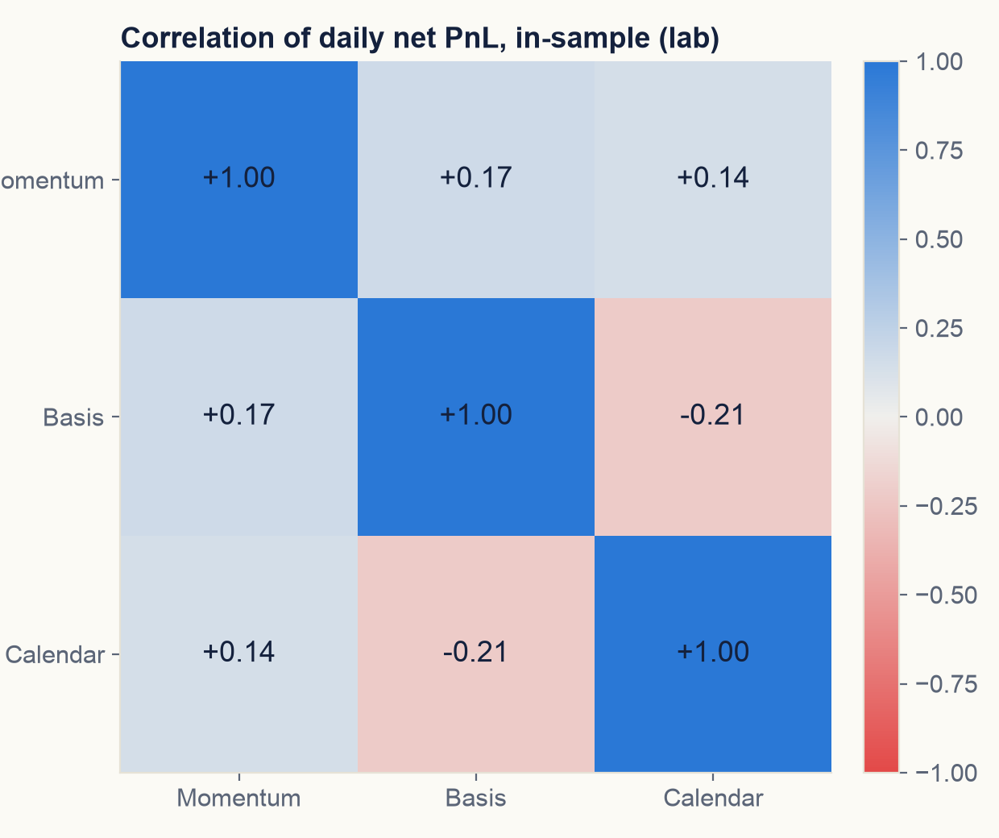
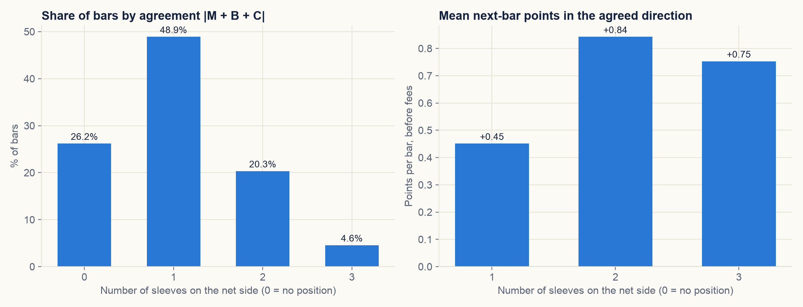

# 5. Tối ưu

Chỉ dùng engine lab, in-sample 01/06/2021 đến 30/12/2022. Các phép thử chọn cấu hình: `scripts/run_step5_selection.py`,
report `reports/step5_selection_lab.json`.

## 5.1 Luật chọn

Chốt ngày 19/10/2026, trước khi chạy các phép thử bên dưới:

1. Sharpe sau phí là thước đo quyết định.
2. Chênh lệch Sharpe dưới 0,2 thì coi là hoà. Khi hoà, chọn phương án có drawdown mỗi hợp đồng thấp hơn, rồi đến phương
   án ít luật hơn.
3. Lưới tham số chỉ dùng để kiểm tra độ ổn định; không thay tham số đóng băng. Cả hai giá trị lân cận phải lãi sau phí và
   giữ ít nhất 70% Sharpe của giá trị đóng băng, nếu không thì tham số được ghi là "đỉnh nhọn".

Lúc viết luật này, kết quả của vote và sum ở chương 4 đã được xem.

| Phép thử | Các phương án | Số lần thử mới |
|---|---|---:|
| Các chân phụ của Calendar | đầy đủ, chỉ chân chính | 1 |
| Ngưỡng vào lệnh của Momentum | 0,14; 0,18; 0,22 | 2 |
| Cửa sổ của Basis | 30; 40; 50 | 2 |
| Cách gộp ensemble | vote, sum | 1 |

## 5.2 Calendar: chân chính so với đầy đủ

Quyết định trước khi chạy: so Calendar chỉ có chân chính (bán thứ Hai, mua thứ Ba và thứ Tư) với Calendar đầy đủ trên
IS. Ba chân phụ (đầu tháng, trước kỳ nghỉ, đáo hạn) được xét chung một nhóm, nên đây là một phép thử chứ không phải ba.
Chỉ giữ nhóm này nếu bản đầy đủ có Sharpe IS sau phí cao hơn rõ; nếu không thì bỏ. Mục 1.1 của chương 1 giải thích vì
sao không thể xét từng chân riêng.

| Calendar | Lãi net (điểm) | Sharpe | MDD (điểm) | Số lệnh | Margin (bps) |
|---|---:|---:|---:|---:|---:|
| Đầy đủ | +837,5 | 2,29 | 218,3 | 115,5 | 26,92 |
| Chỉ chân chính | +629,5 | 1,84 | 205,5 | 114,0 | 20,51 |

Bản đầy đủ hơn 0,45 Sharpe, vượt ngưỡng hoà 0,2, nên giữ các chân phụ. Chúng thêm 208 điểm trong khi số lệnh gần như
không đổi (115,5 so với 114,0).

## 5.3 Các tổ hợp sleeve

Hình và bảng dưới: lab, in-sample 01/06/2021 đến 30/12/2022, quy về 1 hợp đồng (sum chia 3), tạo bằng
`scripts/generate_report_plots.py`. Các cặp gộp bằng vote, sign(A + B), cùng luật phiên.

| Cấu hình | Lãi net (điểm) | Sharpe | MDD (điểm) | Số lệnh | Hit rate | Margin (bps) |
|---|---:|---:|---:|---:|---:|---:|
| Momentum | +886,8 | 2,23 | 100,3 | 312,0 | 52% | 10,48 |
| Basis | +630,2 | 1,81 | 181,3 | 108,5 | 50% | 21,60 |
| Calendar | +837,5 | 2,29 | 218,3 | 115,5 | 61% | 26,92 |
| M+B | +1.281,5 | 3,14 | 105,2 | 268,5 | 56% | 17,69 |
| M+C | +1.253,4 | 3,08 | 88,2 | 277,5 | 53% | 16,63 |
| B+C | +1.208,0 | 3,25 | 104,6 | 161,5 | 59% | 27,62 |
| Vote M+B+C | +1.579,4 | 3,70 | 87,7 | 282,5 | 53% | 20,66 |
| Sum M+B+C | +800,0 | 3,60 | 40,5 | 159,7 | 50% | 18,56 |

Mỗi sleeve đứng riêng đã có lãi sau phí. Ghép thêm sleeve nào, Sharpe cũng tăng: từng sleeve 1,8 đến 2,3, các cặp 3,1
đến 3,3, cả ba 3,6 đến 3,7.

## 5.4 Tương quan giữa các sleeve

| | Momentum | Basis | Calendar |
|---|---:|---:|---:|
| Momentum | 1,00 | +0,17 | +0,14 |
| Basis | +0,17 | 1,00 | −0,21 |
| Calendar | +0,14 | −0,21 | 1,00 |

Tương quan lãi lỗ theo ngày giữa các sleeve đều thấp, và Basis với Calendar còn tương quan âm: cái này hay lãi đúng lúc
cái kia lỗ. Đây là lý do việc gộp làm kết quả đều đặn hơn.

## 5.5 Cách gộp ensemble

Mức đồng thuận |M + B + C| trên các nến in-sample (tín hiệu thô của sleeve), và biến động trung bình của nến kế tiếp
theo hướng ròng, trước phí:

| Số sleeve cùng phía | Tỷ lệ số nến | Biến động trung bình nến sau (điểm) |
|---:|---:|---:|
| 0 (không có vị thế) | 26,2% | |
| 1 | 48,9% | +0,45 |
| 2 | 20,3% | +0,84 |
| 3 | 4,6% | +0,75 |

Khi có hai sleeve đồng ý, giá ở nến kế tiếp đi theo hướng đó gần gấp đôi so với khi chỉ có một sleeve (+0,84 so với
+0,45 điểm). Sum tăng khối lượng theo mức đồng thuận; vote vào đủ một hợp đồng ngay từ khi có một sleeve.

| Ensemble, 1 hợp đồng | Lãi net (điểm) | Sharpe | MDD (điểm) | Số lệnh | Margin (bps) |
|---|---:|---:|---:|---:|---:|
| Majority vote | +1.579,4 | 3,70 | 87,7 | 282,5 | 20,66 |
| Equal-weight sum | +800,0 | 3,60 | 40,5 | 159,7 | 18,56 |

Sharpe chênh 0,10, tính là hoà theo luật; drawdown của sum chưa bằng một nửa của vote, nên sum là lựa chọn chính thức.

## 5.6 Độ ổn định của tham số

| Ngưỡng Momentum | Lãi net (điểm) | Sharpe | MDD (điểm) | Số lệnh | So với Sharpe gốc |
|---:|---:|---:|---:|---:|---:|
| 0,14 | +838,0 | 2,06 | 170,5 | 367,0 | 92% |
| 0,18 (gốc) | +886,8 | 2,23 | 100,3 | 312,0 | 100% |
| 0,22 | +725,5 | 1,95 | 109,9 | 268,0 | 87% |

| Cửa sổ Basis | Lãi net (điểm) | Sharpe | MDD (điểm) | Số lệnh | So với Sharpe gốc |
|---:|---:|---:|---:|---:|---:|
| 30 | +423,5 | 1,14 | 165,5 | 119,5 | 63% |
| 40 (gốc) | +630,2 | 1,81 | 181,3 | 108,5 | 100% |
| 50 | +579,8 | 1,65 | 179,9 | 94,5 | 91% |

- Momentum: ổn định. Cả hai giá trị lân cận đều lãi và giữ trên 85% Sharpe gốc.
- Basis: không ổn định ở phía ngắn. Cửa sổ 30 nến vẫn lãi nhưng chỉ còn 63% Sharpe gốc, dưới ngưỡng 70%. Cửa sổ 50 thì
  đạt. Giữ nguyên cửa sổ 40, và ghi phía ngắn là điểm cần theo dõi ở giai đoạn ngoài mẫu.

## 5.7 Quyết định

Mang sang bước 6, giữ nguyên gói đóng băng và luật ở chương 3:

- Cả ba sleeve, Calendar đủ các chân.
- Ngưỡng Momentum 0,18, cửa sổ Basis 40.
- Ensemble chính thức: equal-weight sum. Majority vote cũng được chạy ở bước 6 để tham khảo.

Số lần thử tích luỹ trong lần chạy lại này: 6 lần ở chương này, cộng với số đã ghi trong `PROTOCOL.md` của từng sleeve.
